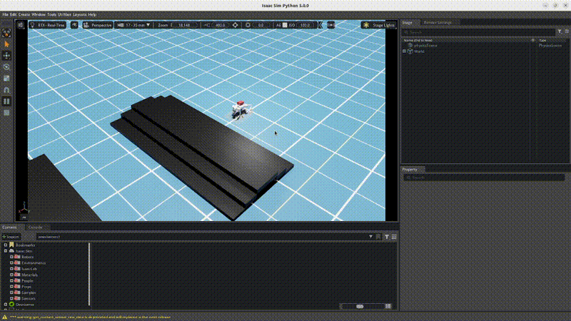
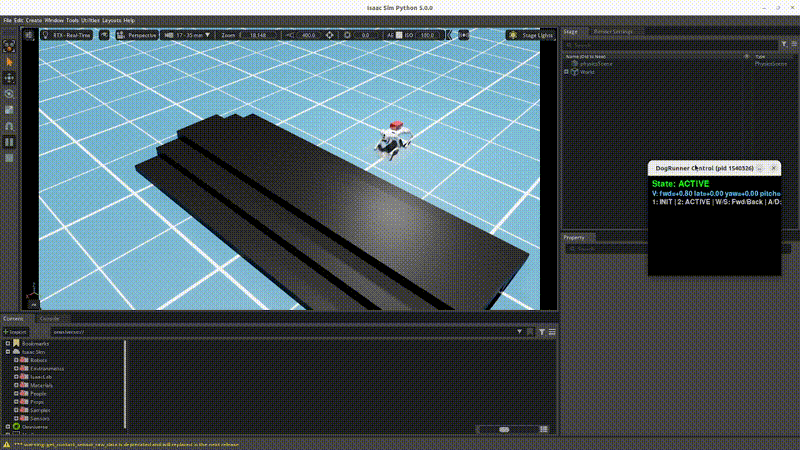

# RL-Augmented Model Predictive Control for Quadruped Locomotion

**Master's Thesis (Grade: 1.0) — Technical University of Munich (TUM)**  
*Chair of Cyber-Physical Systems in Production Engineering*  
**Author:** [Mena Kuzman](https://www.google.com/search?q=https://www.linkedin.com/in/mena-kuzman/) | **Platform:** Unitree Go2 | **Simulator:** NVIDIA Isaac Sim 4.5.0

This repository contains the hierarchical control architecture, reinforcement learning training pipeline, and high-fidelity simulation environment developed for my Master's thesis at the Technical University of Munich. It couples a high-level **Soft Actor-Critic (SAC)** reinforcement learning policy in PyTorch (adapted from [CleanRL](https://github.com/vwxyzjn/cleanrl)) with a modified low-level **Nonlinear Model Predictive Controller (NMPC)** and **Whole-Body Controller (WBC)** (built upon IIT DLS Lab's [Quadruped-PyMPC](https://github.com/iit-DLSLab/Quadruped-PyMPC/tree/main)) to achieve robust locomotion for the **Unitree Go2** quadruped over complex stair terrains and under external payload disturbances.

## Performance Comparison: Standard NMPC vs. RL-Augmented NMPC

Adding the high-level RL policy enables the quadruped to dynamically adapt its step height and swing-phase timing in real time, overcoming stair obstacles where a standard fixed-gait model-based controller fails.

| Baseline (Standard SRBD NMPC) | RL-Augmented NMPC (Proposed Approach) |
| :---: | :---: |
|  |  |
| *Robot struggles with fixed gait timings and rigid foot-swing trajectories on stairs.* | *Robot dynamically adapts step height and swing duration via the PyTorch SAC policy.* |

## System Architecture & Key Contributions

The hierarchical control framework separates terrain-adaptive decision-making from high-frequency optimal dynamic execution:


### 1. High-Level Control: Soft Actor-Critic (SAC) Residual Policy (`PyTorch`)
Implemented in `cpssim-final/rl_sac_planner/` by adapting the single-file PyTorch SAC architecture from [CleanRL](https://github.com/vwxyzjn/cleanrl) for parallel residual policy training in NVIDIA Isaac Sim:
* **State Inputs:** Current robot base states (orientation, linear/angular velocity), foot contact states, and user velocity/yaw commands.
* **Adaptive Residual Outputs:** Continuously modulates the nominal **Step Height** and **Swing-Phase Timing** sent to the low-level gait and swing controllers to accommodate uneven and stepped terrain.

### 2. Low-Level Control: Model-Based Optimal Execution (`CasADi` / `acados`)
Built on top of the open-source [Quadruped-PyMPC](https://github.com/iit-DLSLab/Quadruped-PyMPC/tree/main) framework from the Dynamic Legged Systems (DLS) Lab at IIT, extended and bridged for closed-loop execution in **NVIDIA Isaac Sim 4.5.0**:
* **Adaptive Gait Sequencer:** Computes the contact schedule, phase variables, and nominal foothold targets from user velocity commands and RL timing adjustments.
* **Nonlinear MPC (Single Rigid Body Dynamics — SRBD):** Formulated in **CasADi** and compiled to C via **`acados`** (using HPIPM QP solving), optimizing Center-of-Mass (CoM) trajectories and computing optimal **Ground Reaction Forces (GRFs)** for stance legs under friction-cone constraints.
* **Terrain-Adaptive Swing Trajectory Controller:** Extended (`swing_trajectory_controller.py`, `wb_interface.py`, `terrain_roughness_estimator.py`) to regenerate collision-free foot swing trajectories online using the RL agent's dynamic step-height commands.
* **Whole-Body Controller (WBC):** Combines optimal stance GRFs and desired swing-leg accelerations into physical **Joint Torques** applied to the Unitree Go2 articulation in **NVIDIA Isaac Sim 4.5.0**.

### Summary of Custom Extensions Over Upstream `Quadruped-PyMPC`
| Component | Upstream `iit-DLSLab/Quadruped-PyMPC` | Custom Extensions in This Thesis |
| :--- | :--- | :--- |
| **Simulation Backend** | MuJoCo (`simulation/simulation.py`) | Bridged to **NVIDIA Isaac Sim 4.5.0** (`rl_sac_planner/go2_pympc.py`) with procedural and randomized 3D stair generators |
| **High-Level Adaptation** | Fixed nominal step height & manual gait parameters | **PyTorch SAC residual policy** (`sac_actor.py`, `train_sac_step_height_residual_parallel.py`, adapted from [CleanRL](https://github.com/vwxyzjn/cleanrl)) adapting step height and swing duration online |
| **Swing & Whole-Body Interface** | Static swing height configuration | Real-time swing trajectory regeneration & terrain roughness estimation (`swing_trajectory_controller.py`, `wb_interface.py`, `terrain_roughness_estimator.py`) |
| **Validation Suite** | Flat/rough terrain demos | Automated stair & payload robustness benchmark suite (**3 kg, 5 kg, and 7 kg** payloads on procedural and random stairs) |

## Robustness & Payload Generalization Benchmarks

The closed-loop architecture was systematically benchmarked in **NVIDIA Isaac Sim** across both **procedural** and **randomized stair geometries**, testing zero-shot robustness under external payload disturbances:

* **Stair Climb Validation:** Evaluated standard fixed-height NMPC vs. RL-augmented NMPC across varying riser heights (`cpssim-final/fixed_step_height_stairs_results/`, `cpssim-final/random_stairs/`).
* **Payload Stress Testing (3 kg, 5 kg, and 7 kg):** Validated trajectory tracking, CoM stability, and obstacle clearance on procedural and randomized stairs with additional **3 kg, 5 kg, and 7 kg** payloads (`cpssim-final/procedural_3kg/`, `cpssim-final/procedural_5Kg/`, `cpssim-final/procedural_7kg/`, `cpssim-final/random_stair_3kg/`, `cpssim-final/random_stairs_5kg/`, `cpssim-final/random_stairs_7kg/`).

## Repository Structure

```text
Master_Thesis/
├── BaselineMPC.gif                  # Standard NMPC stair-climbing baseline demo
├── MPC+RL.gif                       # RL-Augmented NMPC stair-climbing demo
├── Hybrid_arch.png                  # Hierarchical SAC + SRBD NMPC + WBC block diagram
├── README.md                        # Project documentation
└── cpssim-final/
    ├── rl_sac_planner/              # High-level PyTorch SAC policy & Isaac Sim Go2 interface
    │   ├── go2_pympc.py             # Closed-loop Unitree Go2 Isaac Sim + PyMPC integration
    │   ├── sac_actor.py             # Soft Actor-Critic policy network architecture
    │   ├── train_sac_step_height_residual_parallel.py  # Parallel residual SAC training
    │   ├── compare_mpc_vs_mpc_rl.py # Automated benchmark runner (NMPC vs. RL+NMPC)
    │   ├── checkpoints/             # Trained SAC policy weights
    │   └── analysis/                # Quantitative trajectory & torque evaluation scripts
    ├── pympc/                       # Modified Quadruped-PyMPC low-level controller
    │   ├── quadruped_pympc/         # SRBD NMPC (CasADi / acados), adaptive swing & WBC
    │   ├── installation/            # Conda environment & acados build configurations
    │   ├── simulation/              # Simulation configuration and terrain wrappers
    │   └── ros2/                    # ROS 2 interface nodes and message definitions
    ├── run_simulation.sh            # Launch script for closed-loop Isaac Sim evaluation
    └── run_compare_mpc_vs_rl.sh     # Launch script for comparative stair/payload benchmarks
```

## Installation & Quick-Start Guide

### Prerequisites
* **OS:** Ubuntu 22.04 LTS (Linux)
* **Simulator:** NVIDIA Isaac Sim 4.5.0
* **Environment Manager:** Miniconda / Mamba (or Pixi)
* **Dependencies:** Python 3.10+, PyTorch, CasADi, `acados`

### 1. Clone the Repository
```bash
git clone https://github.com/Mena-Kuzman/Master_Thesis.git
cd Master_Thesis/cpssim-final
```

### 2. Set Up the `pympc` Conda Environment & Compile `acados`
Create the conda environment and compile the `acados` C solver required by `quadruped_pympc` (see `cpssim-final/pympc/installation/` or the upstream [Quadruped-PyMPC installation guide](https://github.com/iit-DLSLab/Quadruped-PyMPC/blob/main/README_install.md)):
```bash
cd pympc
conda env create -f installation/conda_env.yml || conda create -n pympc python=3.10
conda activate pympc
pip install -e .
pip install torch torchvision
cd ..
```

### 3. Configure `LD_LIBRARY_PATH` for `CasADi` / `acados` C++ ABI Compatibility
When running `CasADi` and compiled `acados` solvers alongside NVIDIA Isaac Sim, prepend your Conda environment's `lib` directory to `LD_LIBRARY_PATH` to prevent `libstdc++` (`CXXABI`) symbol conflicts:
```bash
export LD_LIBRARY_PATH="$CONDA_PREFIX/lib:$LD_LIBRARY_PATH"
```

### 4. Run Closed-Loop Simulation in NVIDIA Isaac Sim
*(Note: Ensure the path inside `run_simulation.sh` points to `cpssim-final/rl_sac_planner` on your machine.)*
```bash
./run_simulation.sh
```
Or launch directly from `cpssim-final/rl_sac_planner/`:
```bash
cd rl_sac_planner
python3 go2_pympc.py
```

### 5. Run Comparative Benchmarks (Standard NMPC vs. RL-Augmented NMPC)
To reproduce the stair-climbing and payload robustness comparisons (3 kg, 5 kg, 7 kg):
```bash
cd rl_sac_planner
python3 compare_mpc_vs_mpc_rl.py --checkpoint ../checkpoints/<your_checkpoint>.pt
```

### 6. Train the High-Level SAC Residual Planner
To train the Soft Actor-Critic policy in parallel simulation environments:
```bash
cd rl_sac_planner
python3 train_sac_step_height_residual_parallel.py
```

## Acknowledgments & Credits

* **Low-Level NMPC & WBC:** Built upon [**Quadruped-PyMPC**](https://github.com/iit-DLSLab/Quadruped-PyMPC/tree/main) (BSD-3-Clause License), developed by the **Dynamic Legged Systems (DLS) Lab** at the **Istituto Italiano di Tecnologia (IIT)** (maintained by Giulio Turrisi and Daniel Ordonez):
  * G. Turrisi et al., *"On the Benefits of GPU Sample-Based Stochastic Predictive Controllers for Legged Locomotion,"* IEEE/RSJ International Conference on Intelligent Robots and Systems (IROS), 2024.
  * M. Elobaid et al., *"Adaptive Non-Linear Centroidal MPC With Stability Guarantees for Robust Locomotion of Legged Robots,"* IEEE Robotics and Automation Letters (RA-L), 2025.
* **High-Level RL Algorithm:** The Soft Actor-Critic (SAC) training pipeline in `cpssim-final/rl_sac_planner/` is adapted from [**CleanRL**](https://github.com/vwxyzjn/cleanrl) (MIT License) by Shengyi Huang et al.
